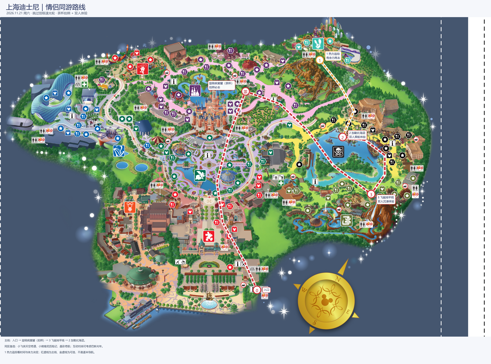

# 上海迪士尼周六一日攻略｜2026年11月21日

> 两人同行版。重点是早点入园、先玩最想玩的项目、按官方 App 实时排队调整，不追求刷完所有项目。

## 手机速览

**主线顺序：入园 → 旋转疯蜜罐（茶杯拍照）→ 翱翔·飞越地平线（优先）→ 加勒比海盗 → 看体力和排队情况加玩热力追踪。**

- **跳过：**创极速光轮、七个小矮人矿山车。
- **情侣加玩优先级：**小飞侠天空奇遇（顺路、轻松）→ 巴斯光年星际营救（双人互动）→ 晶彩奇航（休息看景）→ 小熊维尼历险记（轻松可爱）。
- **想玩刺激一点：**雷鸣山漂流；可能淋湿，结合天气和体力决定。
- **当天调整：**以官方 App 的项目开放状态、实时等候时间和演出时间为准；遇到长队，先玩附近项目，不必为了清单来回折返。

## 官方园区地图

- [打开上海迪士尼官方园区地图 PDF](https://static.shanghaidisneyresort.com/web-img-gallery/park-map-260227.pdf)
- [打开官方互动地图／项目列表](https://www.shanghaidisneyresort.com/zh-cn/experience/?map=true)
- 官方 App 可看地图、项目实时预计等待时间、项目状态和演出安排。以当天 App 为准。

**地图说明：**我尝试在小红书页面搜索，但当前浏览器自动化连接连续超时，无法核验具体笔记或图片。因此路线图采用上海迪士尼官方园区地图作为底图，并由我标注了区域游玩顺序；它不是小红书截图，也不代表官方推荐路线或实时排队情况。图中红白虚线是主线，金色虚线是可选加项；路线按园区区域大致串联，不是逐米导航。到现场后以官方 App 的地图、项目状态和实时等候时间为准。

## 建议路线

### 入园前

- 两人分别准备好购票绑定的身份证原件，提前在官方 App 登录并绑定门票。
- 前一晚确认入园时间、演出表、项目维护和天气。11月早晚温差大，带一件保暖防风外套和舒适鞋。
- 更新后的主线：**入口 → 旋转疯蜜罐（茶杯）→ 3 翱翔·飞越地平线 → 2 加勒比海盗**。创极速光轮跳过；茶杯保留为拍照必去；**1 热力追踪**看体力和队列作为加项；**4 七个小矮人矿山车不安排**。([官方项目介绍](https://www.shanghaidisneyresort.com/zh-cn/experience/attraction/hunny-pot-spin))
- 尽量在开园前抵达安检和入口。周六按热门日来安排，不把开园时间当作到达时间。

### 入园后项目顺序与节奏

1. 入园后先去梦幻世界坐**旋转疯蜜罐（茶杯）**，拍完照再按排队情况决定是否加玩小飞侠或小熊维尼。
2. 然后到探险岛玩**翱翔·飞越地平线（3）**。
3. 再去相邻的宝藏湾玩**加勒比海盗（2）**。
4. 如果还有时间和体力，查看 App 队列后决定是否去疯狂动物城玩**热力追踪（1）**；创极速光轮跳过，七个小矮人矿山车不纳入路线。
5. 午餐错峰；下午优先安排附近短队项目、互动或演出，傍晚按 App 确认巡游和夜间演出时间。

路线标号按这个顺序标注。若项目暂停或等候时间明显偏长，先玩附近短队项目，再决定是否折返。

### 适合情侣一起玩的其他项目

- **小飞侠天空奇遇**：梦幻世界的室内飞行体验，适合作为茶杯附近的加玩项；81 厘米或以上。([官方介绍](https://www.shanghaidisneyresort.com/zh-cn/experience/attraction/peter-pans-flight))
- **小熊维尼历险记**：轻松的室内乘车项目，所有身高可乘；也在梦幻世界，适合顺路加玩。([官方项目列表](https://www.shanghaidisneyresort.com/zh-cn/experience/?group=attraction))
- **晶彩奇航**：慢速乘船看故事场景，适合一起放松、拍照；所有身高可乘。([官方介绍](https://www.shanghaidisneyresort.com/zh-cn/experience/attraction/voyage-to-crystal-grotto))
- **巴斯光年星际营救**：室内互动射击，可以比比两个人谁分数高；所有身高可乘。([官方介绍](https://www.shanghaidisneyresort.com/zh-cn/experience/attraction/buzz-lightyear-planet-rescue))
- **雷鸣山漂流**：想要更刺激可以一起坐漂流，但会有水花、急降和较大音量；107 厘米或以上，怕湿就跳过。([官方介绍](https://www.shanghaidisneyresort.com/zh-cn/experience/attraction/roaring-rapids/))

我建议先把**小飞侠**或**巴斯光年**加进备选：前者顺路、氛围轻松；后者有双人互动感。晶彩奇航适合想休息、看景时安排。

### 排队取舍口诀

- **必玩 + 队伍可接受：排。**
- **必玩 + 长队：先看是否暂停、队伍是否持续下降，再决定等或买尊享卡。**
- **非必玩 + 长队：跳过，逛附近项目。**
- 每完成一个项目就刷新 App；预计等待时间只是估算，现场运营可能变化。
- 迪士尼尊享卡可在购票后通过官方渠道购买。建议先买普通一日票，入园后看实时队伍再决定是否买单项或套装；购买前核对所含项目、适用时段与价格。

## 随身准备

- 身份证、手机、充电宝、官方 App 登录状态
- 保暖外套、舒服且防滑的鞋
- 非玻璃水杯、纸巾、少量常用药
- 轻便小包；不要带自拍杆、折叠椅或大件行李
- 食品按最新《乐园须知》准备，避免需要加热／加工／冷藏或有刺激气味的食物

## 来源与临行核对

- [上海迪士尼官方园区地图 PDF](https://static.shanghaidisneyresort.com/web-img-gallery/park-map-260227.pdf)
- [上海迪士尼官方互动地图与玩乐项目](https://www.shanghaidisneyresort.com/zh-cn/experience/?map=true)
- [上海迪士尼官方门票与入园说明](https://www.shanghaidisneyresort.com/zh-cn/commerce/ticketing-v2/tickets/shdr-theme-park-tickets/ThemePark/booth?categoryId=ThemePark&groupID=ticket-group-shdr-theme-park-tickets-one-day-ticket-hybrid)
- [尊享卡购买渠道与官方 FAQ](https://www.shanghaidisneyresort.com/zh-cn/faq)
- [上海迪士尼官方乐园须知](https://www.shanghaidisneyresort.com/zh-cn/legal/park-rules/)

**出发前一天：**再次确认门票日期、营业时间、项目状态、巡游／夜秀时间和天气；当天路线以 App 现场数据微调。
